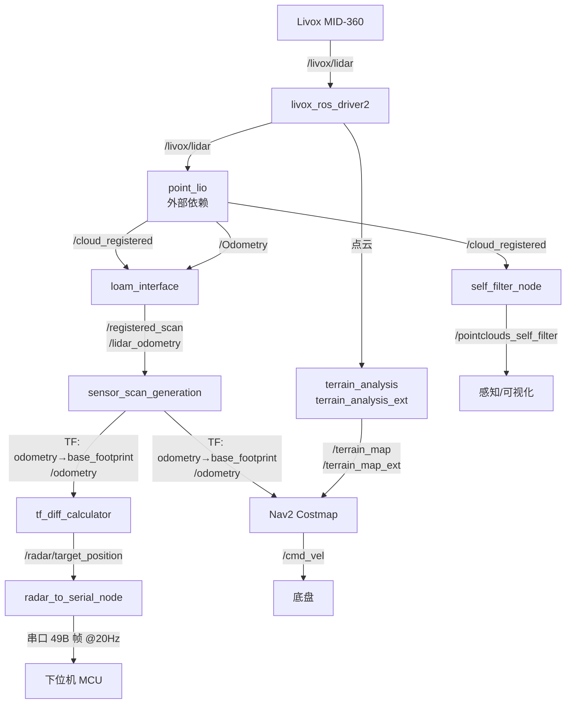

# RM_LIDAR 雷达感知与导航集成模块 (ROS 2)

[](https://docs.ros.org/en/humble/index.html)
[](LICENSE)

## 1. 项目概述

一个服务于 **RoboMaster 超级对抗赛英雄机器人** 的 ROS 2（Ubuntu 22.04 + Humble）上位机集成工作空间。

- **输入**：Livox MID-360 激光雷达点云（`sensor_msgs/PointCloud2`）。
- **中间**：Point-LIO 做激光惯性里程计，两个坐标转换包把位姿/点云统一到 Nav2 要求的坐标系。
- **输出**：
  - 一路进 **Nav2**（代价地图 + 规划 + 控制），做自主导航与避障；
  - 一路经 **自定义串口协议** 把目标位置/距离下发给下位机 MCU（弹道解算）。

> **关于命名**：仓库名含 "Radar"，但传感器是 **Livox MID-360 激光雷达（LiDAR）**，不是毫米波雷达。命名沿用队内工程习惯。

### 自研 vs 集成：边界说明

本仓库的价值主要在**系统集成与接口层**，而非算法。自研代码约 **400 行 C++**，分布如下：

| 部分 | 行数 | 性质 |
| :--- | :--- | :--- |
| `src/bringup/src/*.cpp`、`include/bringup/radar_data_converter.hpp` | ~400 | **自研**：串口协议、TF 差值节点、车体自滤波 |
| `src/bringup/launch/`、`src/bringup/config/` | ~500 | **自研/配置**：系统集成、Nav2 参数、TF 铺设 |
| `src/livox_ros_driver2/` | 4295 | Livox 官方 ROS 2 驱动（搬运，MIT） |
| `src/bringup/lib/serial/` | 4196 | `wjwwood/serial` 串口库（vendored，MIT） |
| `src/loam_interface/`、`src/sensor_scan_generation/` | 546 | 源自 Lihan Chen 等的同名包，**本仓库仅调整了坐标系与话题参数**（Apache-2.0） |
| `src/terrain_analysis/`、`src/terrain_analysis_ext/` | 1496 | 源自 CMU 地面移动机器人栈的同名包，**参数改用 `nav2_params_terrain_analysis.yaml` 下发**（BSD） |

第三方组件清单与许可证见 [`NOTICE.md`](NOTICE.md)。

## 2. 系统架构与数据流



> `point_lio`、`pb_nav2_plugins` 与 `pb_omni_pid_pursuit_controller` 不随本仓库发布，
> 见 [`dependency.repos`](dependency.repos)。`terrain_analysis` 与其 `_ext` 版本已随本仓库发布。

## 3. 自研节点说明

| 节点 | 功能 | 主要 ROS 参数 |
| :--- | :--- | :--- |
| `self_filter_node` | 用 PCL `CropBox` 抠掉机器人本体点云，避免把自身结构当成障碍物。这是**纯几何空间裁剪**，不含点云聚类/语义分割。 | `input_topic`(默认 `/cloud_registered`)、`output_topic`、`crop_min_x/y/z`、`crop_max_x/y/z`、`output_frame` |
| `tf_diff_calculator` | 以 10 Hz 查询两个坐标系间的变换，把平移部分作为 `PointStamped` 发布，即"目标位置"。 | `source_frame`(默认 `odometry`)、`target_frame`(默认 `enermy_base`)、`publish_period_ms`、`tf_timeout_sec` |
| `radar_to_serial_node` | 把目标位置、基准点、距离打包成自定义帧，按 20 Hz 走串口下发给 MCU。距离由 `target-base_point` 的欧氏范数就地计算，不依赖外部话题。 | `serial_port`、`baud_rate`、`target_topic`、`base_point_x/y/z`、`send_period_ms`、`max_data_age_sec` |

设计要点：

1. **目标位置已经表达在 `enermy_base` 坐标系下**，因此"基地基准点"就是该坐标系原点 `(0,0,0)`，外部再输入 base_point 只是可选覆盖。改参数即可，不需改代码。
2. **陈旧数据一律丢弃**：`max_data_age_sec` 之外的数据不组帧，绝不把过期位置发给下位机做弹道解算。
3. **所有帧名/话题/边界值都是 ROS 参数**，现场调参不需要重新编译。

## 4. 数据维度速查

| 数据 | 消息类型 | 维度 / 结构 | 说明 |
| :--- | :--- | :--- | :--- |
| 原始点云 | `sensor_msgs/PointCloud2` | **N 点 × 7 字段**；`point_step = 26 B`（`#pragma pack(1)`） | 字段：`x,y,z`(FLOAT32)、`intensity`(FLOAT32)、`tag`(UINT8)、`line`(UINT8)、`timestamp`(FLOAT64)。`height=1`，`width=N` |
| IMU | `sensor_msgs/Imu` | **10 维**：姿态四元数 4 + 角速度 3 + 线加速度 3 | 话题 `livox/imu`，另含 3 个 9 元协方差矩阵 |
| 里程计 | `nav_msgs/Odometry` | **7 + 6 维**：pose(x,y,z + 四元数 4)、twist(线速度 3 + 角速度 3) | 另含 2 个 36 元协方差矩阵 |
| 坐标变换 | `geometry_msgs/TransformStamped` | **6 自由度**：平移 3 + 四元数旋转 4 | tf2 缓冲里即为 SE(3) 刚体变换 |
| 自滤波点云 | `sensor_msgs/PointCloud2` | **M 点 × 3 字段**（`pcl::PointXYZ`，x/y/z FLOAT32），M ≤ N | 已剔除车体包围盒内的点 |
| 目标位置 | `geometry_msgs/PointStamped` | **3 维** 笛卡尔坐标 | `/radar/target_position`，10 Hz |
| 静态地图 | `nav_msgs/OccupancyGrid` | **560 × 300 格 = 168000 格**，每格 int8（-1/0~100） | `resolution = 0.05 m` ⇒ 实际 28 × 15 m |
| 局部代价地图 | `nav2_msgs/Costmap` | **60 × 40 格 = 2400 格**（3 × 2 m @ 0.05 m，rolling window） | 每格代价 0~255 |
| 全局代价地图 | `nav2_msgs/Costmap` | **560 × 300 格**（随地图），叠加 **垂向 16 层体素 × 0.05 m = 0.8 m** | 即常说的 **2.5D**：2D 栅格 + 体素柱高度 |
| 串口下行帧 | 自定义二进制 | **9 个标量 → 44 B payload**，整帧 **49 B** | 见下一节 |

一句话总结：**点云是 7 维/点、位姿是 6 自由度、地图是 2.5D 栅格、下发给你 MCU 的是 9 个标量。**

## 5. 串口下行协议

准确帧格式（共 **49 字节**）：

```
偏移:  0        1    2     3 .......................... 46   47       48
       +--------+----+----+============================+----+--------+
字节:  | 0xAA   | LEN_H |  | payload (44 B)            |XOR | 0x55   |
       +--------+----+----+============================+----+--------+
          1B      1B   1B            44B                 1B     1B
```

| 偏移 | 长度 | 内容 |
| :--- | :--- | :--- |
| 0 | 1 | 帧头 `0xAA` |
| 1 | 1 | payload 长度高字节（当前固定 0x00） |
| 2 | 1 | payload 长度低字节（当前固定 0x2C = 44） |
| 3–46 | 44 | payload（见下表） |
| 47 | 1 | XOR 校验（对 payload 逐字节异或） |
| 48 | 1 | 帧尾 `0x55` |

payload 布局：

| 顺序 | 字段 | 类型 | 字节 |
| :--- | :--- | :--- | :--- |
| 1 | `distance` | double | 8 |
| 2–4 | `position_x/y/z` | float × 3 | 12 |
| 5–7 | `base_point_x/y/z` | float × 3 | 12 |
| 8–10 | `dx/dy/dz`（position − base_point） | float × 3 | 12 |

带宽核算：115200 bps 8N1 ⇒ 11520 B/s；49 B × 20 Hz = 980 B/s，占用约 **8.5%**，余量充足。

## 6. TF 树

```
map ─(static, 零变换)─→ odometry
odometry ─(static, x=21.5)─→ enermy_base
odometry ─(dynamic, sensor_scan_generation)─→ base_footprint
base_footprint ─(static, 0, -0.1682, 0.396)─→ livox_frame
aft_mapped ─(static, 零变换)─→ body
```

> 已知问题：`bringup.launch.py` 里还有一条 `base_footprint → odom` 的静态变换，方向与传统 `map→odom→base_link` 相反，且 `odom` 与 `odometry` 是两个不同的帧。清理前请勿依赖 `odom`。

## 7. 外部依赖（不随仓库发布）

```bash
pip3 install vcstool
cd ~/rm_ws
vcs import src < src/Radar-System-ROS2-Package/dependency.repos
```

| 功能包 | 用途 |
| :--- | :--- |
| `point_lio` | 激光惯性里程计（`/Odometry`、`/cloud_registered`） |
| `pb_nav2_plugins` | 提供 `pb_nav2_costmap_2d::IntensityVoxelLayer` |
| `pb_omni_pid_pursuit_controller` | 提供 `nav2_params*.yaml` 中 `FollowPath` 用的 `OmniPidPursuitController` |

> 早期版本把 `terrain_analysis` 列为外部依赖，现已 vendored 进本仓库（`src/terrain_analysis`、
> `src/terrain_analysis_ext`），产出代价地图订阅的 `/terrain_map` 与 `/terrain_map_ext`。

## 8. 编译与运行

```bash
mkdir -p ~/rm_ws/src && cd ~/rm_ws/src
git clone https://github.com/Aurelia-Maris-Crystalthrone/Radar-System-ROS2-Package.git
cd ~/rm_ws
vcs import src < src/Radar-System-ROS2-Package/dependency.repos
rosdep install --from-paths src --ignore-src -r -y
pip3 install transforms3d numpy matplotlib
colcon build --symlink-install
source install/setup.bash
ros2 launch bringup bringup.launch.py
```

雷达 IP / 挂载位姿 / 串口号分别在
`src/livox_ros_driver2/config/MID360_config.json`、
`src/bringup/launch/bringup.launch.py`（静态 TF）、
`src/bringup/launch/bringup.launch.py`（`serial_port` / `baud_rate`）中修改。

## 9. 关键话题

| 话题 | 消息类型 | 发布者 | 频率 |
| :--- | :--- | :--- | :--- |
| `/livox/lidar` | `PointCloud2` | livox_ros_driver2 | 10–20 Hz |
| `/livox/imu` | `Imu` | livox_ros_driver2 | ~200 Hz |
| `/cloud_registered` | `PointCloud2` | point_lio（外部） | 10–20 Hz |
| `/Odometry` | `Odometry` | point_lio（外部） | 高（可达 kHz 级） |
| `/registered_scan` | `PointCloud2`（换系后） | loam_interface | 同点云 |
| `/lidar_odometry` | `Odometry`（换系后） | loam_interface | 同里程计 |
| `/odometry` | `Odometry` | sensor_scan_generation | 同里程计 || `/pointclouds_self_filter` | `PointCloud2` | self_filter_node | 同点云 |
| `/radar/target_position` | `PointStamped` | tf_diff_calculator | 10 Hz |
| `/terrain_map`, `/terrain_map_ext` | `PointCloud2` | terrain_analysis（外部） | 10 Hz |
| `/cmd_vel` | `Twist` | Nav2 controller_server | 随控制器 |

## 10. 已知缺口 / TODO

- `map → odometry` 为**零**静态变换：未启用 AMCL / `robot_localization`，上电默认位于地图原点。
- `enermy_base` 是硬编码 `x=21.5` 的静态 TF：目标位置来自先验坐标，**不是感知检测的结果**。
- 尚未包含 Dockerfile；中间件使用默认 DDS 配置，未做共享内存 / 零拷贝调优。
- 仓库历史为单次提交，缺少迭代过程；后续建议拆分为功能化的多次提交。
- `global_costmap` 的 `intensity_voxel_layer` 依赖第三方插件，换用官方 `voxel_layer` 需同步改参数。

## 11. 许可与第三方声明

本仓库自研部分遵循 **Apache-2.0**（见 [`LICENSE`](LICENSE)）。所包含/依赖的第三方组件及其许可证详见 [`NOTICE.md`](NOTICE.md)。
其中 Point-LIO 采用 GPLv2，商业部署前请确认许可要求。
